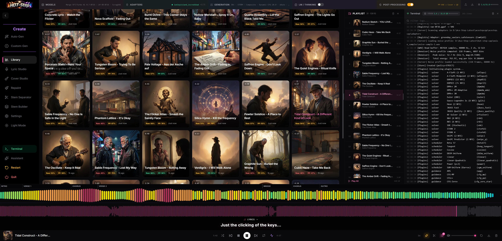
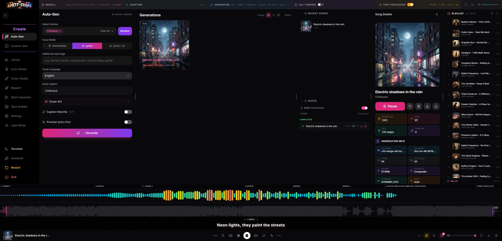
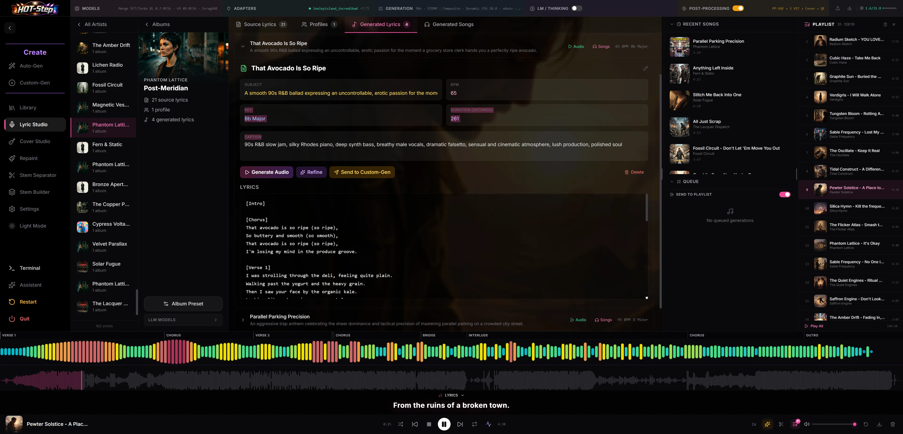
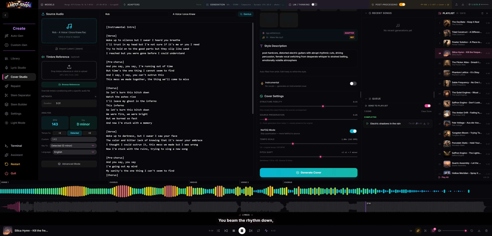
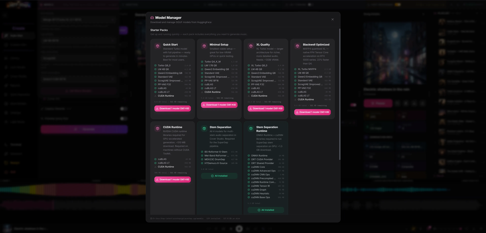

# HOT-Step CPP

A desktop app for local AI music generation, built on [acestep.cpp](https://github.com/ServeurpersoCom/acestep.cpp) and GGML. Describe a song with a style caption and lyrics and get stereo audio back, generated entirely on your own hardware with no cloud, API keys or subscription. Four backends run natively in the C++ engine and switch from the sidebar: **ACE-Step 1.5**, **MiniMax-Music3**, **YuE2** and **Stable Audio 3**. It also runs on Windows, Linux and macOS, in Colab, and from your phone (a RunPod image arrives with the next release).

**Questions, feedback, or want to share what you've made?** [Join the Discord](https://discord.gg/ezVtmg9GKX). It's where I'm most active for HOT-Step discussion and support.

> ### Training Studio
> Train style adapters for ACE-Step 1.5, MiniMax-Music3, YuE2 and Stable Audio 3 inside the app, with no Python and no external tools. Point it at a folder of songs and it runs the whole pipeline: dataset labelling (local BPM/key analysis, lyrics, and AI captions from a model running on your machine), preprocessing, then native C++/GGML training on your GPU. YuE2 adds a Joint Training method that trains its AR and NAR adapters in one run. Training against a quantized base at a smaller rank brings the MiniMax-Music3 VRAM floor from 31.4 GB down to about 10 GB. Runs pause, resume and survive a restart. MiniMax-Music3, YuE2 and Stable Audio 3 runs render audio previews at checkpoints; on ACE-Step, Audition compares adapters and saved milestones instead.
>
> It is GPU-hungry, and a few individual options inside it are still marked experimental. Find it in the sidebar as **Training**, and read [Training Studio](docs/user/studios/training-studio.md) first.

## Download

Portable releases, no installation needed: extract and run. Node.js is bundled.

**[Download the latest release](https://github.com/scragnog/HOT-Step-CPP/releases/latest)**

| Platform | Variants |
|---|---|
| **Windows** (x64) | CUDA (NVIDIA), Vulkan (AMD/Intel/NVIDIA), CPU |
| **Linux** (x64) | CUDA (NVIDIA), Vulkan (AMD/Intel/NVIDIA), ROCm (AMD), CPU |
| **macOS** (Apple Silicon) | Metal |

Use CUDA on an NVIDIA card, Vulkan on AMD or Intel, and CPU only if there is no usable GPU, since it is much slower. There are several CUDA builds for different card generations; [Getting started](docs/user/getting-started.md#pick-a-download) has the table that says which file to take.

### Quick start

1. Download the archive for your platform and GPU, and extract it into a folder of its own. Your library, models and settings go in a `HOT-Step-Data` folder that the app creates beside it, so a later version finds them again ([Data folder and upgrades](docs/user/data-folder.md)).
2. Run `HOT-Step.bat` on Windows, or `./HOT-Step.sh` from a terminal on Linux and macOS.
3. Your browser opens at `http://localhost:3001`. Leave the console window open; closing it stops the app.
4. The Model Manager opens on first launch. Download the **Quick Start** pack from the ACE-Step 1.5 tab (about 9 GB). The engine starts by itself once the download finishes.
5. Write a style description and lyrics in **Custom-Gen** and click **Generate**. The full walkthrough is in [Getting started](docs/user/getting-started.md).

### Windows blocks the app (Smart App Control or SmartScreen)

The release files are not code-signed, so Windows can refuse to start `HOT-Step.bat` or the bundled executables.

- **SmartScreen ("Windows protected your PC"):** click **More info**, then **Run anyway**. If the zip itself was flagged, right-click it before extracting, open **Properties**, tick **Unblock** and click **OK**.
- **Smart App Control (the app is blocked with no "Run anyway" option):** open **Windows Security**, then **App & browser control**, then **Smart App Control settings**, and set it to **Off**. Windows only lets you turn this back on by resetting the PC, so decide before you switch it.
- Extract the archive into a folder of its own before running, not from inside the zip.

## Highlights

- **Four backends, one app.** ACE-Step 1.5, MiniMax-Music3, YuE2 and Stable Audio 3 run in the same engine process. The backend picker appears whenever two or more are registered, the sidebar lists only the studios the active backend supports, and the global bar hides controls that do nothing on it. See [Backends](docs/user/backends.md).
- **Training Studio.** Style adapters for ACE-Step 1.5, MiniMax-Music3, YuE2 and Stable Audio 3, trained on your own GPU. See [Training Studio](docs/user/studios/training-studio.md).
- **Auto-Gen and Custom-Gen.** Pick a genre and let the language model write the caption, lyrics and title, or set every field yourself. See [Auto-Gen](docs/user/studios/insta-gen.md) and [Custom-Gen](docs/user/studios/create.md).
- **Lyric Studio.** A lyrics workspace with artist profiles, several LLM providers, bulk generation and the same generation controls as Custom-Gen. See [Lyric Studio](docs/user/studios/lyric-studio.md).
- **Cover Studio.** Style-matched covers of a reference track on ACE-Step and YuE2. ACE-Step conditions on the source audio directly; YuE2 adds a two-step Prepare flow (fix the structure, assign lyrics) and a Build page that assembles the song section by section. MiniMax-Music3 covers are included but not yet working right: you are free to test them, but the results are not production-grade yet. See [Cover Studio](docs/user/studios/cover-studio.md).
- **Repaint, Song Builder and Stem Builder.** Regenerate one region and keep the rest, build a song a section at a time, or generate a new instrument stem over a backing track (ACE-Step). See [Repaint Studio](docs/user/studios/repaint-studio.md), [Song Builder](docs/user/studios/song-builder.md) and [Stem Builder](docs/user/studios/stem-builder.md).
- **Compare.** A/B listening with one shared playhead for seed sweeps, plugin tests and checkpoint ladders, with a loudness and spectral analyser. See [Compare](docs/user/studios/compare-studio.md).
- **STORM.** A live performance mode that streams crossfaded slots while you retune the style, lyrics, seed and sampler. It runs on ACE-Step and YuE2. See [STORM](docs/user/studios/storm.md).
- **Stem separation.** BS-RoFormer, Mel-Band RoFormer, MDX23C and Leap Xe running in native GGML, with a mixer and ZIP export. See [Stem Separator](docs/user/studios/stem-studio.md).
- **MIDI Studio.** Audio-to-MIDI transcription on a native GGML port of MuScriptor, with tempo and bar detection, a live piano roll and playback. See [MIDI Studio](docs/user/studios/midi-studio.md).
- **Lua plugins.** Solvers, schedulers, guidance modes and postprocess steps are Lua files: drop one into the `plugins/` folder of your data folder (or `engine/plugins/` in a source checkout) and it appears in the UI at the next launch, no rebuild. See [Plugins](docs/user/plugins.md) and [Plugin authoring](docs/dev/plugins-authoring.md).
- **LoRA, LoKr and DoRA adapters.** Merge or runtime mode, per-group strengths, stacking, and per-section masking from the lyrics. See [Adapters](docs/user/adapters.md).
- **Post-processing chain.** Mastering against a reference track, a VST3 host, StableStep refinement through Stable Audio 3, PP-VAE and denoising. See [Generation](docs/user/generation.md#post-processing).
- **Model Manager.** Starter packs and every model file, downloaded in the app with resumable progress, including importance-matrix quants that keep the small sizes usable. See [Model Manager](docs/user/studios/model-manager.md) and [Model files](docs/user/models.md).
- **Phones and the PWA.** A navigation drawer, a full-screen player and narrow-screen layouts for Custom-Gen, Lyric Studio, Repaint, Stem Separator, MIDI Studio and Training, and over HTTPS the app installs to your home screen. See [Install on your phone](docs/user/getting-started.md#install-on-your-phone).
- **DAW facade.** `/api/v1/daw` lets a DAW client generate and analyse audio against the running app. See the [API reference](docs/dev/api.md#daw-facade-notes-apiv1daw).
- **Agents.** Two local MCP servers let an agent drive the app. See [MCP](docs/user/mcp.md).
- **Colab.** No suitable GPU? Use the Colab notebook ([guide](docs/user/colab.md)).

The full list, one line per feature, is in [FEATURES.md](FEATURES.md).

## Gallery

### Library
Browse your generated songs as a cover art grid with AI-generated artwork, quality scores, and audio metadata. The right sidebar shows a live playlist and engine terminal output. The bottom bar has a waveform visualizer with section markers (verse, chorus, bridge) and real-time synced lyrics.

### Auto-Gen
AI-driven music creation: pick a genre, set a vocal mode, and the LLM handles the rest. The song details panel shows full generation metadata: models used, solver, scheduler, CFG scale, key signature, time signature, and duration.

### Lyric Studio
A lyrics workspace. Browse artists and albums on the left, view and edit AI-generated lyrics with structural section tags in the centre, and manage your generation queue on the right. Supports multiple LLM providers for lyric generation and refinement.

### Cover Studio
Upload a reference track for automatic BPM and key detection via Essentia analysis. The engine extracts style descriptions, lyrics, and structural metadata. Cover settings include structure fidelity, source preservation, pitch shift with key transposition, and tempo scaling.

### Model Manager
Curated starter packs for different hardware tiers, from minimal setups to Blackwell-optimized configurations. Download individual GGUF models, stem separation networks, and CUDA runtime libraries from Hugging Face without leaving the app.

## Documentation

- [Documentation index](docs/README.md): every page, for users and contributors.
- [FEATURES.md](FEATURES.md): one line per feature, each linking to its page.
- [Getting started](docs/user/getting-started.md): download, first launch, first model pack, first song.
- [Backends](docs/user/backends.md): what each of the four models does, and a capability matrix.
- [Getting higher quality output](docs/user/quality.md): quants, prompts, steps, and a per-backend cheat sheet.
- [Troubleshooting](docs/user/troubleshooting.md): logs, common failures, and what to put in a bug report.

For contributors:

- [Architecture](docs/dev/architecture.md): the engine, server and UI tiers, and how a request flows through them.
- [Building from source](docs/dev/building.md): prerequisites, the dev loop, engine rebuild rules, packaging.
- [Writing and maintaining the docs](docs/dev/docs-contributing.md): layout, page template, and the docs checker.
- `AGENTS.md`: local project rules for coding agents.

## Platform support

| Platform | GPU backends | Pre-built release |
|---|---|---|
| Windows x64 | CUDA, Vulkan, CPU | Yes |
| Linux x64 | CUDA, Vulkan, ROCm, CPU | Yes |
| macOS Apple Silicon | Metal | Yes |

## Building from source

For Colab, see [Running on Google Colab](docs/user/colab.md).

Most people should use a [release](#download). To build it yourself, including the engine, the dev loop and portable packaging, follow [Building from source](docs/dev/building.md). On Linux and WSL the root `Makefile` covers the whole flow with `make setup`, `make build`, `make install` and `make run`; on Windows use `dev.bat` and `LAUNCH.bat`.

## Troubleshooting

Every session writes its logs to a new folder under `logs/` in your data folder (by default `HOT-Step-Data`, beside the extracted app folder): `node_console.log`, `ace_engine.log`, and one `gen_*.log` per generation.
[Troubleshooting](docs/user/troubleshooting.md) covers the common failures (no models found, out of VRAM, GPU not used, macOS blocking the app) and what to attach to an issue.
Questions rather than bugs go to the [Discord](https://discord.gg/ezVtmg9GKX).

## Credits

- **[ACE-Step 1.5](https://github.com/ace-step/ACE-Step-1.5)**: the AI music generation model by ACE Studio and StepFun.
- **[acestep.cpp](https://github.com/ServeurpersoCom/acestep.cpp)**: the C++ GGML inference engine by ServeurpersoCom.
- **[minimaxmusic.cpp](https://github.com/ServeurpersoCom/minimaxmusic.cpp)**: ServeurpersoCom's independent MiniMax-Music3 port. HOT-Step's MM3 split-model format follows its per-component design, reused with the author's blessing.
- **[MiniMax-Music3](https://huggingface.co/MiniMaxAI/MiniMax-Music3)**: text-to-music model by [MiniMax](https://huggingface.co/MiniMaxAI), powering HOT-Step's second backend through our native C++/GGML port ([GGUF conversion](https://huggingface.co/scragnog/MiniMax-Music3-GGUF)). The MM3 Structured Caption format is MiniMax's design. Weights under the [MiniMax-Music3 Community License](https://huggingface.co/MiniMaxAI/MiniMax-Music3/blob/main/LICENSE).
- **[YuE2](https://huggingface.co/m-a-p/YuE2-3B)**: text-to-music model by [m-a-p](https://huggingface.co/m-a-p) (Multimodal Art Projection), powering HOT-Step's third backend through our native C++/GGML port ([GGUF conversion](https://huggingface.co/scragnog/YuE2-GGUF)). Weights under [CC BY-NC 4.0](https://creativecommons.org/licenses/by-nc/4.0/). The authors have clarified that individuals (creators, musicians, researchers) may use the model and its outputs freely, including commercially; only companies need a commercial licence (gezhang@umich.edu).
- **[Ruach Studio](https://github.com/igrbible/Ruach_Studio)**: the YuE2-RS fine-tunes of YuE2-3B ([goldhub/YuE2-RS-Finetunes](https://huggingface.co/goldhub/YuE2-RS-Finetunes)). The First Wave 4.0x0.7 merge and both Tsunami Wave merges (2.0x0.75 and 2.0x0.9) are offered in the Model Manager through our own GGUF conversions ([First Wave](https://huggingface.co/scragnog/YuE2-RS-4.0x0.7-GGUF), [Tsunami Wave](https://huggingface.co/scragnog/YuE2-RS-TW-GGUF)). Licensed [CC BY-NC-SA 4.0](https://creativecommons.org/licenses/by-nc-sa/4.0/), and our conversions carry the same licence.
- **[MOSS-Music-8B-Instruct](https://huggingface.co/OpenMOSS-Team/MOSS-Music-8B-Instruct)**: music understanding and captioning model by the [OpenMOSS Team](https://huggingface.co/OpenMOSS-Team), powering local dataset captioning in Training Studio through our native GGML port ([GGUF conversion](https://huggingface.co/scragnog/MOSS-Music-8B-Instruct-GGUF)). Local captioning in a free tool was only possible because they released it under Apache 2.0.
- **[HOT-Step 9000](https://github.com/scragnog/HOT-Step-9000)**: the Python-based sister project.
- **Alexander Allan ([MDMAchine](https://github.com/MDMAchine))**: the STORM solver plugin (adaptive STORK/DPM++3M hybrid) and the MD Audio Tiled Core postprocess plugin (tiled VAE decode with OLA crossfading, dual-pass merge, and a DSP chain).
- **[ComfyUI_MusicTools](https://github.com/jeankassio/ComfyUI_MusicTools)**: the Vocal Naturalizer DSP algorithm by Jean Kassio (MIT License).
- **[JK-AceStep-Nodes](https://github.com/jeankassio/JK-AceStep-Nodes)**: the Audio Quality Evaluator metrics by Jean Kassio (MIT License).
- **[Stability AI](https://stability.ai)**: Stable Audio 3 (diffusion transformer, SAME-L autoencoder and T5Gemma text encoder), powering HOT-Step's fourth backend, its Stable Audio 3 training and the StableStep refiner through our native GGML conversions, distributed under the [Stability AI Community License](https://stability.ai/community-license-agreement). *Powered by Stability AI.*
- **[MuScriptor](https://github.com/muscriptor/muscriptor)**: multi-instrument music transcription model by Kyutai and Mirelo (Simon Rouard, Michael Krause, Axel Roebel, Carl-Johann Simon-Gabriel, Alexandre Défossez, [arXiv:2607.08168](https://arxiv.org/abs/2607.08168)), powering MIDI Studio through our native GGML port (code MIT, model weights CC BY-NC 4.0).

## License

HOT-Step CPP is released under the MIT License. See [LICENSE](LICENSE).

Some parts carry their own terms:

- **`engine/`** is MIT, copyright the acestep.cpp authors. See [engine/LICENSE](engine/LICENSE).
- **MDMAchine's plugins** (most of the `md_*` files under `plugins/`, and `storm_sampler_core.lua`) are GPLv3. Each one says so in its header, and the header decides. Releases ship them as source alongside the MIT code, so a release as a whole must meet the GPLv3's terms. The rest of the code remains MIT.
- **Model weights** are not covered by this licence. Each model is under its own terms, listed in the credits above.

Contributions are accepted under the repository licence (MIT) unless a file says otherwise.

## Acknowledgments

- **Alexander Allan ([MDMAchine](https://github.com/MDMAchine))**, for ongoing and generous contributions: the STORM solver and MD Audio Tiled Core postprocess plugins, the real-time VST3 monitoring UX (chain presets, live monitor transport, pause/resume/restart), and a run of JUCE VST3 hosting crash fixes in the engine. This project is better for it.
- **AI-Toolkit**: inspiration for HOT-Step's YuE2 Joint Training method.
- **MotherSuperior** (kytr.ai, [Hugging Face](https://huggingface.co/Mothersuperior)): the original YuE2 encoder that turns songs into the codes the YuE2 trainers learn from.

### The MiniMax-Music3 encoder effort

MiniMax released MiniMax-Music3's weights but not its audio encoder, the piece that turns audio into the RVQ codes the model is trained on. Without one, nobody outside MiniMax could build a training set or train an adapter. A group in the Discord reconstructed it in the open, and HOT-Step's MM3 training exists because they did.

- **[bghira](https://huggingface.co/bghira)** designed the encoder architecture everyone else built on, and published the first working open encoder along with the corpus to train it.
- **[PurpleOrc](https://huggingface.co/PurpleOrc)** trained that architecture from scratch on a 53,000-track corpus built with a deliberate push on non-English lyrics, producing the encoder that took the crown and held it.
- **[Mothersuperior](https://huggingface.co/Mothersuperior)** (kytr.ai) generated distillation corpora on rented L40S fleets, pooled them with everyone else's, and published the pooled encoders back to the group.
- **[Serveurperso](https://huggingface.co/ServeurpersoCom)** contributed a pilot corpus and hidden-state encoders, and measured the real ceiling: decoding from the exact teacher hidden state scores 0.9326, so the semantic top-1 wall everyone kept hitting was the teacher's own sampling entropy, not something more data could train past. That saved the group a lot of wasted compute.
- **testerf**, **redsitouwu** and **afkaf** ran evaluations, argued the metrics into shape, and caught the trap that cross-entropy measures plausibility to the frozen LM rather than fidelity to the audio. That is why the group's gate became CE as a sanity floor, code diversity as an alarm, and a listening test as the verdict.

Thank you, all of you. It was collaborative reverse engineering done in the open, and it unlocked a feature this project could not have shipped alone.

## Star history

If HOT-Step is useful to you, consider giving it a star. It really helps.

