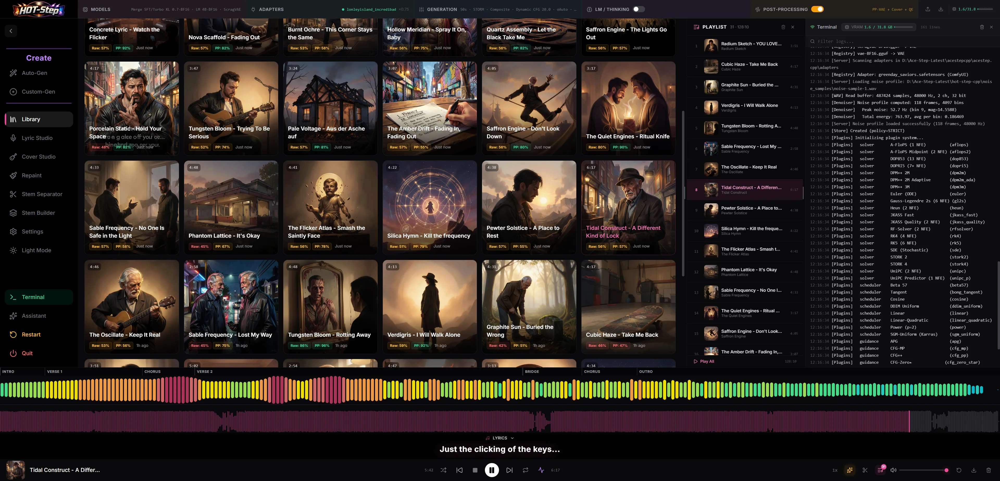

# Library

Every song you generate or import lands here. Browse it as a cover art grid, a
compact list, or a data-dense table, filter by which studio made a track,
select several at once, and open a track for its full parameter breakdown,
lyrics, and metadata. The player, the playlist queue, and the song details
panel all live alongside it and are covered on this page too.

## Where to find it

Sidebar entry: Library. No model or backend has to be loaded first, it works
on whatever songs are already in the database, including ones imported from
disk.

## Workflow

1. Open Library from the sidebar.
2. Pick a view (grid, list, or table) and, optionally, a source filter tab to
   narrow the list to one studio's output.
3. Click a track to open its details in the right sidebar, or hover it for
   quick play/download/menu controls.
4. Use the track's action menu (or the right sidebar) for edit, download,
   send-to-Cover-Studio, metadata, or delete.
5. To bring in audio from outside the app, click Upload into Library and drop
   the files in.

## Controls

| Control | What it does |
|---|---|
| View toggle (grid / list / table) | Switches how the song list renders. Remembered per browser. |
| Source filter tabs | All, Custom-Gen, Auto-Gen, Lyric Studio, Cover Studio, Repaint, Stem Build, Song Builder, Imported. Each tab shows a count and filters client-side; only shown on the Library page, not on the Generations lists beside Custom-Gen and Auto-Gen. |
| Select | Enters multi-select mode: check tracks, then Compare (two or more tracks, opens a new [Compare](compare-studio.md) session with them picked), Add to playlist, Zip (one zip of the selected tracks' original audio, up to 500 tracks and 256 MB), Download or Delete the selection. Select all / deselect all toggles from the checkbox at the left of the bulk action bar; Select all visible and Clear sit beside it. Shift+click selects the range from the last clicked track, Ctrl/Cmd+click toggles one. On touch, long-press a track to start selecting, tap to toggle, and long-press a second track to select the range between them. |
| Per page | 20, 40 (the default), 60, 80, 100, or All. Remembered per browser. |
| Columns (table view only) | Choose which columns show. The cover thumbnail, Title and Actions are always on. Style, BPM, Key, Model, Quality, Time and Date (and Source on the All tab) show by default; the generation details, such as seed, LM seed, steps, CFG, shift, solver, scheduler, guidance, LoRA, LM and VAE, are off until you tick them. Column widths are drag-resizable and persist. |
| Rename (pencil icon) | Inline title edit, on the card, row, or table cell. |
| Track menu (⋯) | Run Post-Processing (shown greyed out, with the reason on hover, when it cannot run), Remove Post-Processed Version (when one exists), Download ABC Lead Sheet (YuE2 renders), Edit (loads the track's parameters back into Custom-Gen), Add to Playlist, Download, Send to Cover Studio, Edit Metadata, Export Params, Retranscribe Lyrics (the item spins and a toast names the Whisper model it picked, with a Cancel button; the same toast then reports the line and word counts), Download .LRC (when the track has synced lyrics), Generate/Regenerate Cover Art, Set as Track A / Track B, Delete. The same menu sits on grid cards, list rows, table rows, the playlist and the right sidebar, with the items that surface supports. On phones (1023px wide or less) it opens as a bottom sheet instead of a dropdown: drag the handle down, tap the backdrop or press Esc to close it. |
| Set as Track A / Track B | Pins two tracks for the A/B comparison bar above the list, with a Play A/B button and a Compare button that opens a parameter diff modal. |
| Upload into Library | Opens the import dialog (see below). Only on the Library page. |

A track still being rendered by MiniMax-Music3's streaming mode appears in
the list before its file exists, with a live percentage badge and progress
bar; the grid card hides its menu until then. It is already playable, just
not downloadable yet.

## Comparing generation settings

Grid cards, list rows and table titles show small parameter badges. YuE2 shows
the saved AR adapter scale and VAE variant. ACE-Step shows CFG, solver and
model quantization when the model filename identifies it. MiniMax-Music3 shows
flow CFG, adapter scale and model quantization when recorded. Stable Audio 3
shows its saved guidance and sampler. Missing values stay hidden; settings
from another backend's panel do not appear. A track scored by the Quality
Evaluator (see [Generation](../generation.md)) also shows its score as a
percentage, Raw and PP when both versions were scored; hover it for the
metallic, word-cut and noise scores.

Cover Studio's **Covering band** label appears as a Tag line under the title
in grid cards and table titles, and beneath the description in list rows.
Long values truncate with their full text on hover. Disguise mode hides the
tag. Open **How it was made** for the saved source identity and cover choices.
Older tracks can only show the information saved at generation time.

**Export Params** includes stored cover provenance and the YuE2 score, when
present. **Edit** opens Custom-Gen; it does not restore the Cover Studio workflow
or reload its source. Keep a Cover Studio draft to resume that workflow.

## Player

The transport bar at the bottom of the window is global: it stays visible
across every view, not just Library.

| Control | What it does |
|---|---|
| Shuffle / previous / stop / play-pause / next / repeat | Standard transport. Repeat cycles off → all → one. |
| Spectrum toggle | Shows/hides the frequency analyzer above the waveform. |
| Disco mode | Cosmetic pulse visualization synced to the track. |
| Playback speed | Cycles 0.5x / 0.75x / 1x / 1.25x / 1.5x / 2x. |
| Lock screen / media keys | The current track (title, artist or backend, cover art) shows in the OS media overlay and phone lock screen. Play, pause, previous, next and seeking work from there and from headset or keyboard media keys. |
| 48k / 44.1k | Previews how the 48 kHz render sounds clocked out at 44.1 kHz, pitched down about 1.47 semitones with tempo unchanged. A quick way to A/B a resample artifact without actually resampling. |
| Variant switch (No Adapter / Unmastered / Mastered) | Only shown when a track has that variant. Each segment plays it and carries its own small download button for that exact render. |
| A / B (after Play A/B) | Takes the variant switch's place: shows which pinned track is playing and flips to the other; the x beside it leaves A/B mode. |
| Trim/crop | Toggles trim mode; the waveform below becomes clickable to set in/out points. |
| Volume | Slider plus mute toggle. |
| Edit / Download / Delete | Quick actions on the currently loaded track. |

Above the transport, a collapsible area (only expands while something is
playing, or trim mode is on) holds section markers, the waveform, a
synced lyrics bar, and, when both slots are filled, the A/B mini-bar.

On a phone, tap the song title or cover in the mini player to open the
full-screen player, covering the viewport even with Disco mode enabled:
large cover art, title and backend, a big waveform you
can tap to seek plus a scrub bar with a large thumb, and big transport
buttons. Close it with the chevron at the top, by swiping down, or with the
Android back button. Closing and reopening keeps Back within the app;
switching studios does not navigate back during player cleanup.

Clearing the current track removes its lock-screen metadata and playback
position. Selecting a paused track afterwards restores its media controls
and playback position.

## Lyric timing

Whisper's timings are usually close, and the error is often one constant offset: every line a
little early or a little late. The other common case is a line that covers two phrases, so it
appears before it is sung. Both are fixed by hand, in the lyric editor.

Expand the **Lyrics** strip under the waveform and click **Edit** in its header. The pencil is
there only when the strip is open and the track has word timings (a Whisper retranscription, or
a render whose lyric aligner wrote them), so editing is never one stray click away. The editor
opens over the app:

- **Transport**, along the bottom, is the player itself: play/pause, seek by 1 s or 0.1 s, speed
  at 0.5x, 0.75x or 1x, volume, and Follow, which keeps the playhead in view while it plays.
  Follow can be switched off and the choice is remembered. Dragging the timeline while it is on
  switches Follow off with a toast saying Follow has been disabled, so the pan is never snapped
  back; the paging arrows do the same.
- **The timeline** is one row per lyric line with a chip per word, against a seconds ruler with
  tenths. Drag a chip to move that word: a timestamp follows its leading edge so the exact
  landing time is visible while you move it. Click a chip to select it. Dragging empty timeline
  pans the view (it never moves the playhead); a click that does not drag seeks there. The grey
  strip above it is the track's waveform, tall enough to place a word against the transient you
  hear rather than by arithmetic. Arrows on the left and right edges page the view by words: back
  scrolls left one window so the first word on screen ends up last, forward scrolls right one
  window so the last word on screen becomes the first.
- **The line being sung** is the last row of the editor, under the transport, as karaoke read
  from the editor's own timings, so a placement can be checked without closing the modal.
- **Zoom** is the point of the modal. It lives in the bottom-left corner of the footer as a short
  slider, so it costs the timeline no height; it runs from 30 to 600 pixels per second, and at
  300 a syllable is wide enough to read and place. `Ctrl+-` and `Ctrl+=` change it from anywhere,
  the frame-the-word button beside it fills the view with the selected word, and the ruler's tick spacing follows on its own
  (15 s, 5 s or 1 s). **Scroll to the playhead**, beside it, brings the view back after a pan.
- **A selected word** gets its own row: nudge it by a step you set (1 to 1000 ms), **Start at
  playhead** puts its onset exactly where the audio is, and **Loop word** replays it so the
  placement can be judged by ear. **Play from word** starts a moment before it. The same row shows
  how long the word lasts and has **Len -** and **Len +** buttons: a selected word carries a white
  handle at each end, and dragging one changes where that edge sits, so the word can be made longer
  or shorter as well as moved. **Export lyrics**, at the right end of the transport row, downloads
  the `.lrc` for the timings on screen, saving pending changes first.
  **Snap to prev** starts it exactly where the word before it ends (across a line break too),
  which is how a word with a gap before it gets pulled onto the syllable.
- **Auto shift**, on by default in the transport row, decides what happens when a word is made
  longer than the room before the next one: on, the words after it move later by the overhang, so
  the spacing you set survives and nothing overlaps; off, the word stops at the next word's start.
  Hovering the switch explains it. Words cannot overlap either way — a drag or nudge stops at the
  previous word's end, and a save repairs any overlap the same way, so two words can never share
  an instant.
- **Split line** cuts the line in two at the **selected word** (or at the word under the playhead
  when nothing is selected), which is the fix for a line that spans two phrases: the selected word
  becomes the first word of the new line, so the break lands exactly where that syllable is sung
  rather than wherever the playhead happens to sit. **Merge previous** and **Merge next**, beside
  it, fold the line into its neighbour (the words are re-sorted, so the result stays in order). All
  three keep every word's timing.
- **Whole track** moves every word by the step, for an offset that is wrong all the way through.
  **From selected** moves the selected word and everything after it by the step, left or right:
  the fix for timing that drifts as the track goes on, because the part already right stays put.
-  The timeline keeps empty space below the last line, so the final line can be scrolled up to the
  middle before it is edited. The step box applies what you type when you leave it or press Enter,
  so a three-digit step no longer passes through one and ten.

**Auto save**, in the footer, is on by default: changes are written about a second after the last
one, the header says **Saving…**, **Saved** or **Unsaved**, and no Save button is shown because
there is nothing to press. Switch it off and the green **Save** appears instead: nothing is written
until it is pressed, closing with unsaved edits asks first, and the choice is remembered.
**Reload saved** stays available either way. Every change
is undoable — the header's arrows, or `Ctrl+Z` and `Ctrl+Shift+Z` — one entry per action, with a
whole drag counting as one. Clicking outside the modal does nothing; close it with the X or
Escape, which asks before throwing away edits that are still unsaved. A save writes the word
timings and rebuilds the `.lrc`, taking each line's start from its first word, so a line no
longer lights up before its own syllable. The strip, the waveform ticks and an exported file then
agree.

Keys, while the editor is open: `Space` plays and pauses even when a word is selected, the arrow
keys move the selected word by the step, `Shift` with them shortens and lengthens it, `Ctrl+-` and
`Ctrl+=` zoom, `Ctrl+Z` and `Ctrl+Shift+Z` undo and redo, and `Esc` closes. Every button's tooltip
names the key it answers to.

A track whose timings were placed by hand is marked as hand-timed when it is saved.
**Retranscribe Lyrics** then refuses the first click and says so; clicking again within a minute
means overwrite. If a crop, a retranscription or another window changes the file while the editor
is open, the save is refused: the footer turns red and offers **Reload**, which reads the file as
it is now and discards the edits on screen, instead of writing the old timeline back. A failed
save is not retried on a timer. The badge reads **Not saved** and the green **Save** stays there
until it works.

The waveform above the transport shows the same timing with the editor closed: a faint rule at
every line, a short tick per word, and the syllable being sung in pink.
## Keyboard shortcuts

On desktop these work anywhere in the app. Press `?` to see them in a small cheat sheet.

| Key | Action |
|---|---|
| Space or K | Play / pause |
| J / L | Seek back / forward 10 s |
| Up / Down | Move the focused row in the visible song list, Library or a Generations list (outlined in pink) |
| Enter | Play the focused row |
| Delete | Delete the selection, or the focused row if nothing is selected. |
| Esc | Clear the selection, then the focused row |
| ? | Open the cheat sheet |
| Ctrl+K (Cmd+K on Mac) | Open the command palette, also while typing in a field |

Shortcuts are off while you type in a field, while a dialog is open, and in Compare studio,
which has its own keys (B, Tab).

### Command palette

On desktop, Ctrl+K (Cmd+K on Mac) opens a search box that jumps anywhere. Type a few
letters of a studio name ("trn" finds Training) or a song title;
the list ranks studios first, then songs from your library. Use Up and
Down to move, Enter to open, Esc to close. Picking a song opens Library and
plays it.

## Playlists

The playlist is a play queue, not a saved collection. There is one queue, not
multiple named playlists. Playback position and device settings stay local to
the browser, but the queue's order and track variants save to the server as a
revisioned snapshot. Queue entries retain their order and variant URLs without
a live song row. Deleting the underlying audio makes that entry unavailable.

Find it in the right-hand Activity column (Playlist tab, alongside Recent
Songs). Add a track with the list-plus icon next to it anywhere in the app,
or "Add to Playlist" from its action menu. From the playlist itself:
reorder with the up/down arrows, remove a track with the x, or use the
footer's Play All, Download All, and Clear. Clicking the track that is already
loaded pauses or resumes it in place; Play All always restarts the queue from
the top. The same pause/resume rule applies to the track in Recent Songs, Recent
Covers, and the generation queue.

If the panel finds an older browser-local playlist, choose **Import browser
playlist** to move that snapshot to server storage; the browser copy stays in
place. A save error shows under the header, and **Reload and reapply** retries
the pending edit against the latest saved revision.

## Song details

Click a track (outside of selection mode) to open the right sidebar.

- Cover art, inline-editable title, a backend chip (ACE-Step 1.5,
  MiniMax-Music3, YuE2 or Stable Audio 3), the artist name if set, and the
  subject or description text.
- Play/pause, Edit, and the same track action menu as everywhere else.
- Chips for length, tempo, key, and time signature, shown only when the
  backend that made the track actually measures them. ACE-Step reports all
  three; the other backends store no tempo, key or time signature, so those
  chips are omitted rather than showing a meaningless value.
- Collapsible sections: Prompt (the style/caption text), How it was made
  (the parameters that render's own backend used, grouped as Models,
  Sampling, Planner, Adapters, Reproduction for ACE-Step; Render, Adapter,
  Reproduction for MiniMax-Music3; Plan, Render, Outcome, Adapters,
  Reproduction for YuE2; Models, Sampling, Reproduction for Stable Audio 3;
  a Cover Studio group comes first on a cover), and Lyrics.

For new YuE2 renders, Score says "Supplied (ABC)" only when the submitted
score was used. Scores generated by the app's planner, including auto-replans
and instrumental planning, say "Planned by LM", and the Outcome group's Plan
stage reads "Planned by the app" rather than "Not run". Older saved tracks
retain their recorded status.

For a rendered YuE2 cover, **Measure drift** in the details panel aligns its
saved audio to the lyrics used by that job, then matches sung lyric tags to
like-labelled score sections in order. The readout shows each section's first
Vocal note, its boundary, and the sung time span. Start offsets in bars use the
note onset; the panel also shows their mean absolute offset and the first
section more than one bar off. It lists unmatched sung tags and why any section
is unscored, including low word confidence. The live result uses the mix alone
and says that vocal-stem agreement has not been checked.
Sections without a vocal note or matching lyrics show **Instrumental / N/A**
and are excluded from the vocal-section scoring count. Section names do not
decide eligibility: an intro, interlude, solo or outro with lyrics and vocal
notes is measured. Low-confidence vocal sections remain unscored; instrumental
skipping does not lower the word-confidence cutoff.
The measurement is saved with the song; opening details alone does not run the
aligner. If the rendered score has free tempo, the calculation uses the
reviewed source score's tempo and labels that fallback.

Drag the handle on its left edge to resize the panel.

### Metadata editor

Edit Metadata, from the track menu, opens a small form: title, artist,
album, year, genre/style, BPM, key, comment, lyrics, and a cover image
upload. Title, genre, BPM, key, lyrics, and cover replace the song's own
record and show up elsewhere in the library immediately. Artist, album,
year, and comment are embed-only overrides: they get written into the
audio file's tags on download without changing what the library displays
for the track.

## Download and export

A track's Download action uses the format, bitrate, and preferred version
(original / mastered / both) set on the Settings page. There is no
per-download format prompt. When Settings has a Download folder, every
download is saved there instead, with a toast saying where; the zip export
still arrives as a browser download. The player's variant switch has its own
inline download buttons that bypass that preference and grab an exact
version instead. Selecting tracks and choosing Download in the bulk action
bar downloads them one at a time, staggered so the browser doesn't block
them; Zip is the single-archive option.

The server chooses the available versions for a bulk download. If the
preferred mastered version is missing, it uses the original. With Both
selected, it downloads the original and the mastered version when both
exist. A failed track is reported separately, so other selected tracks
can still download.

Export Params, on the track menu, downloads that render's parameters as a
JSON preset file, separate from the audio and not affected by the
Settings page format.

Download .LRC, also on the track menu, saves the track's synced lyrics as an
`.lrc` file for external players, DAWs and datasets. It only appears when the
track has timings to export, meaning either the render's own lyric alignment
or a run of Retranscribe Lyrics. The file is named exactly like the audio
download (prepend, artist, title, and the `- Unmastered` suffix when the
preferred version is the original), so a player that pairs a sidecar by
filename finds it. When Settings has a Download folder, the file is saved
there; otherwise it arrives as a browser download. A download of the audio
itself, in folder mode, also writes the matching `.lrc` beside it.

With Enhanced LRC (word timings) on in Settings, the exported file carries an
`<mm:ss.xx>` stamp before every word, which players that support enhanced LRC use
for word-by-word highlighting. A track without word timings still exports, with
plain lines.

Downloaded audio has metadata (title, artist, album, year, genre, comment,
cover art) embedded into the file server-side; WAV downloads with no
metadata to add are streamed straight from disk rather than re-encoded.

## Importing your own audio

Upload into Library (header button, and in the empty-state) accepts
`.wav`, `.mp3`, `.flac`, `.m4a`, `.mp4`, `.aac`, `.ogg`, `.opus`, `.webm`,
`.aiff`, and `.aif`. No generation is involved: an imported track becomes
an ordinary library row and gets everything a render has: post-processing,
downloads, playlists, metadata editing.

The browser uploads each chosen file, then asks the server to import the
uploaded assets. A failed file appears in the import result without
stopping the other files. The server never reads a path from the device;
choose each file in the picker.

The optional description field is used as the file's genre tag when it has
none of its own, and as the target caption if you also opt into "Run
post-processing after import". Post-processing runs the chain configured in
the Post-Processing menu, one imported track at a time; without a
description, the StableStep stage in that chain refuses to run for a file
with no genre tag (every other stage still runs).

## Cover art

Generate/Regenerate Cover Art, on the track menu, opens a prompt editor
pre-filled with the same prompt the app would build automatically from the
track's title, style, and lyrics. Edit it freely before generating; Reset
puts the auto-built prompt back. Cover art generation needs the
FLUX.2-klein-4B model downloaded once, from the Cover Art section of the
Post-Processing menu; if it isn't installed yet, the error names the exact
files still missing.

To set a cover without generating one, use the image upload in the metadata
editor instead.

## Tips and limits

- Deleting one track from its menu happens immediately, with no
  confirmation. Bulk delete (via Select) does ask first.
- The playlist queue's local pointer is per-browser, even though its order
  now saves to the server. It is not the place to keep a track safe. Use the
  library itself, or download the file, for that.
- "How it was made" only ever shows the fields the track's own backend
  used. A YuE2 or MiniMax-Music3 song will not show ACE-Step's step count or
  CFG scale, because those fields were never read for that render.
- View mode, column choices, and page size are saved per browser, not per
  account. They don't follow you to another machine.
- Settings has an "include latent file" download toggle, for tracks that
  have one. It adds a second download of the raw latent alongside the audio
  and is not a Library control.

The Library reuses a recent list when you return. Creating, importing, editing
or deleting songs refreshes the affected library views. Generation completion
adds the finished song once, even when the queue and submitting panel both
follow it. A failed write keeps the previous saved result visible.

## Related

- [Auto-Gen](insta-gen.md)
- [Custom-Gen](create.md)
- [Compare](compare-studio.md)
- [Cover Studio](cover-studio.md)
- [Repaint Studio](repaint-studio.md)
- [Stem Studio](stem-studio.md)
- [Generation](../generation.md)
- [Troubleshooting](../troubleshooting.md)
