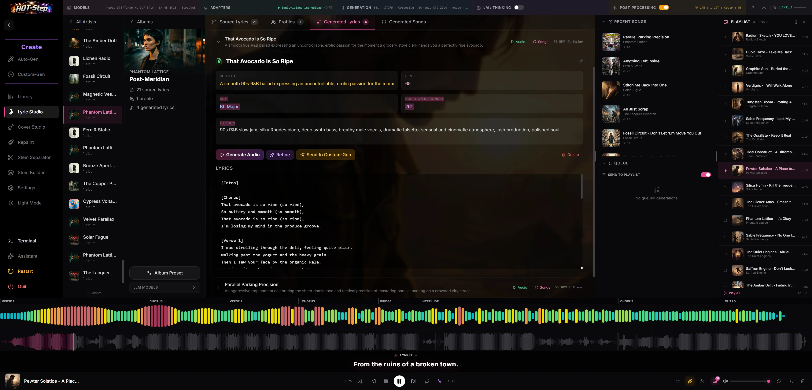

# Lyric Studio

An AI-assisted lyric-writing workspace, backed by its own database of artists,
albums and generations. Fetch or type in a set of source lyrics, have an LLM
learn the writer's style as a profile, generate new lyrics from that profile,
refine them, then send the result to Custom-Gen to render as audio. It also
holds the per-album adapter presets (ACE-Step, MiniMax-Music3 or YuE2) that a
song renders under.

## Where to find it

Sidebar entry **Lyric Studio**. Lyric generation, refinement, profile building
and captioning need at least one LLM provider configured. See
[Controls > LLM providers](#llm-providers) and
[Getting started](../getting-started.md) for API keys. Fetching lyrics from
Genius needs a Genius access token, set with the API keys under Settings > AI
Services. None of this is required to type lyrics in by hand and send them to
Custom-Gen.

An external agent (Claude Code, Codex) can also drive Lyric Studio through the
`lyricstudio` MCP server. See
[tools/mcp-lyricstudio/README.md](../../../tools/mcp-lyricstudio/README.md).

## Workflow

1. Add an artist: **Fetch from Genius** (artist name or Genius URL, with an
   optional album and a max-songs cap) or **Add Manually** from the artist
   grid's **Add Artist** menu.
2. Select the artist, then select an album to open its detail view. Songs
   fetched with no album name land under **Top Songs**.
3. On the **Source Lyrics** tab, review the fetched songs, edit or delete any
   of them, or add one by hand.
4. On the **Profiles** tab, click **Build New Profile** to have the profiling
   LLM analyse the source lyrics and produce a style profile (themes, tone,
   rhyme schemes, structural patterns, vocabulary statistics).
5. On the **Generated Lyrics** tab, click **Generate Lyrics** (or the faster
   **Generate (No Thinking)**) to write a new song from the album's newest
   profile. Set a count to generate several at once, and an optional subject
   to steer the topic.
6. Expand a generated song to edit its title, subject, BPM, key, duration,
   lyrics, and its caption fields; each saves when you click away. Or click
   **Refine** to have the refinement LLM write a revised copy, saved as a new
   song marked **Refined** (title and lyrics change; the metadata generated
   with them does not).
7. Click **Generate Audio** to queue a render from this song's lyrics and
   caption, or **Send to Custom-Gen** to open [Custom-Gen](create.md) with
   the lyrics, caption, title, artist, key/BPM and the album's adapter preset
   already filled in.
8. The **Generated Songs** tab lists every audio render made from this
   album's lyrics, playable inline. A song's **Songs** button opens it
   filtered to that song's renders.

For working through many albums or songs at once, open **Bulk Operations**
from the sidebar of the artist list or of an artist's album page (on a
narrow screen, the **Queue** button on the artist list). See
[Bulk operations](#bulk-operations) below. Esc steps back from an album to
its artist, and from an artist to the artist list.

### Instrumental collections

Training Studio exports instrumental tracks with empty lyrics, an instrumental
flag, captions in all available formats, BPM, key and duration. You can edit the
artist and album names before exporting, including when the source is a
collection. Re-exporting a mixed album adds its instrumental tracks; existing
albums stay as they are until re-exported.

Open the tracks on **Source Lyrics** to read their captions. The album preset
accepts adapters and a reference track without a lyric profile. Export links
the saved MM3 checkpoint and YuE2 pair as well as ACE-Step adapters while
preserving other preset settings. An assigned MM3 adapter makes the album
available in the MM3 Cover Studio grid.

Lyric profiles and lyric statistics use vocal songs only. An album with no
lyric songs builds a **Sound profile** from its source captions and measured
tempo, keys, genres, signatures and duration range, without lyric analysis.
In **Generated Lyrics**, **Generate instrumental** creates a title, mood or
scene, BPM, key, duration and separate ACE-Step, MM3 and YuE2 captions. The
planner reads the source captions in all three formats and avoids repeating
past subjects, tempos, keys, durations and titles. Subject and extra instructions
still steer the result. Duration stays within the source tracks' range.

Instrumental generations keep the `[Instrumental]` marker in place of lyrics.
Refine and the lyric editor are unavailable with an explanation. **Write Lyrics**
points to the sound-profile generation path. Captions and metadata remain
editable; audio generation, bulk queues, presets and **Send to Custom-Gen**
carry the instrumental setting. MM3 still offers automatic, named-track and
custom caption sources. Mixed albums keep their vocal lyric profile.

## Controls

### Write lyrics from a prompt

Add an artist and an album manually, then open the album's **Write Lyrics**
tab. Choose a local Ollama model and enter a **Theme**, or paste your own
**Starter lyrics**. **Style** steers the genre and mood; **Structure** can
specify section order and length. Both are optional. Configure Ollama's address
and default model under **Settings > AI Services** first.

Click **Write lyrics**. No Genius token, source songs or learned profile are
needed. The job continues if you leave the tab, and reopening it reconnects
to the job. Your brief is kept in this browser for that album.

The completed song saves under **Generated Lyrics**, with a title, tagged
lyrics and musical caption. A prompt-based profile is saved with it to keep
the album's normal library relationships. You can edit, refine, send to
Custom-Gen or render the lyric using the existing controls. This tab writes
the whole song; it does not regenerate individual sections.

| Control | What it does |
|---|---|
| Fetch Lyrics (artist grid's "Add Artist", or an artist's "Add Album") | Pulls songs from Genius by artist name/URL and optional album name/URL, up to a max-songs cap (1-100, default 50). Needs `GENIUS_ACCESS_TOKEN`. |
| Add Manually (artist / album / song) | Creates an artist, album, or a single song's lyrics without Genius. |
| Has *engine* adapter (left artist list, under the name filter) | Off by default. On, the list shows only artists with at least one album whose preset assigns an adapter for the active engine: the MM3 adapter on MiniMax-Music3, either YuE2 half on YuE2, the adapter on ACE-Step and the rest. The album counts in that list and the artist's album page narrow to the same albums. Switch engines and the list follows. Stays set for the browser session. |
| Build New Profile | Runs the profiling LLM over every source song in the album and saves a style profile: themes, common subjects, tone and mood, vocabulary notes, structural and narrative patterns, rhyme schemes, meter and repetition statistics. Streams its output live. |
| Generate Lyrics / Generate (No Thinking) | Writes a new song from the album's newest profile with the generation LLM, using past generations for that artist to avoid repeating subjects, keys, titles, BPMs and durations. "No Thinking" asks the model to skip its reasoning phase, when it has one. The Count selector (1 to 5, 8 or 10) writes several in a row. The subject field steers the topic without dictating content. |
| Skip Thinking (live output) | Shown while a generation or refinement is in the model's thinking phase. Cuts that LLM call short; the step goes on with whatever answer text had already arrived, which can be none. |
| Refine | Rewrites a generated song's lyrics and title with the refinement LLM, keeping its captions and other metadata; the result is saved as a new generation linked back to the original. |
| Title / Subject / BPM / Key / Duration | Editable inline on an expanded song; blur to save. |
| Caption (ACE-Step / YuE2) | The caption box that ACE-Step and YuE2 both render from. On YuE2, when the album's dataset has per-track captions, a source picker offers the track nearest in tempo, a named track, or this song's own caption. Until you pick, it uses the nearest-tempo track when the album preset names a YuE2 adapter, and the song's own caption when it does not. |
| MM3 Caption | MiniMax-Music3's three-heading Structured Caption, a different text from the ACE-Step/YuE2 caption above, generated alongside the lyrics. Carries the same source picker (nearest tempo / named track / custom) when the album has captioned source tracks. |
| YuE2 Caption | YuE2's one-sentence planner caption (language, genre, vocal, instruments, mood, production, BPM in that order). Plain text; no source picker of its own, because a song with one no longer borrows a dataset track's caption. |
| Generate Audio | Queues an audio render of this song through the active backend, using the current global generation parameters plus the album's adapter preset. |
| Send to Custom-Gen | Opens [Custom-Gen](create.md) with this song's lyrics, caption, title, artist, subject, key/BPM/duration and the album's adapter preset (or MM3/YuE2 adapter) already applied. |
| Render as… (on an expanded song) | Renders this song with another album's settings: pick the album, then Generate Audio or Send to Custom-Gen. The song keeps its lyrics, captions, tempo and key; the adapters, reference track and artist name come from the chosen album, and on MiniMax-Music3 and YuE2 so does the caption source (nearest tempo among that album's tracks, unless the song is set to its own caption). The recording is listed in the chosen album's Generated Songs tab, marked with the album the song came from, and not under its own album. |
| Render from… (Generated Lyrics toolbar) | The same thing from the other side: in the album you want to render as, pick another album and one of its written songs. |
| Album Preset | Per-album settings for the active backend: on ACE-Step, a DiT adapter folder with per-group scale sliders (self-attn, cross-attn, MLP, cond-embed), a planner-LM adapter folder, and a reference audio track for timbre conditioning; on MiniMax-Music3, one LM adapter, picked from the runs trained on this album's own dataset or any other installed adapter; on YuE2, the AR (song planner) and NAR (audio renderer) adapter halves, picked from the installed adapters or filled in from an Adapter folder you point at (for example `yue2-joint-adapters\refined`), which is scanned for both halves. See [Adapters](../adapters.md) and [Backends](../backends.md). |
| Edit System Prompts | Views and overrides the four Lyric Studio system prompts (Generation, Metadata Planning, Artist Profiler, Refinement), with a reset to the built-in prompt. The code icon beside Bulk Operations opens it. |
| LLM providers (Profile / Generate / Refine rows) | Independent provider+model choice for each of the three LLM roles, under the LLM Models fold in the sidebar. See [LLM providers](#llm-providers) below. |
| Filename Prepend | Text added to the front of downloaded audio filenames. One value for this browser, used by every track download in the app, not only this artist's songs. |
| LLM Duration | On by default: renders use the duration saved with the song, the one in its Duration field. Off: the duration is recalculated from the lyrics and BPM at render time instead. |
| Master to Album Track | Off by default. When on, every Lyric Studio render is mastered to a random track from the album's training dataset, a different one each time, with Mastering turned on and the VST chain skipped for those renders. Your post-processing settings are not changed. An album with no training dataset keeps the mastering reference as set. |
| Randomize Timbre | Picks a random track from the reference folder as the timbre conditioner on each render, instead of the album preset's one fixed reference track. ACE-Step only; hidden on the other backends. |
| Use LM Adapter | Off by default. When on, Generate Audio and Send to Custom-Gen also apply the album preset's planner-LM adapter alongside the DiT adapter; when off, they clear the planner-LM adapter. ACE-Step only; hidden on the other backends. |
| Bulk Operations | Opens the queue panel described below. |

### Bulk operations

The **Bulk Operations** panel works across every artist and album at once, in
five modes: **Build Profiles** (queue profile builds for the albums you tick
among those with no profile yet), **Generate Lyrics** (queue lyric writing for
profiled albums, 1 to 20 per profile or a **Fill to target** mode that tops each
profile up to a chosen total, with a No Thinking toggle and a filter that hides
profiles already holding enough generations), **Generate Audio** (queue audio
rendering for already-written songs, per album, all of them or a fixed number
taken newest or oldest first, leaving out songs already generated or already
downloaded), **Assign Presets** (bulk-apply an ACE-Step DiT adapter with group
scales, a planner-LM adapter and a reference track across albums, with Select
Missing and Select Incomplete shortcuts) and **Fetch Lyrics** (batch Genius
fetches for a pasted list of `Artist | Album` lines or for rows you fill in,
with a Max Songs cap of 1 to 200, default 50).

Profile builds, lyric writing, refinement, bulk lyric fetches and bulk audio
renders run as server jobs. Closing the panel does not stop a submitted job;
the lyric queue reconnects to unfinished jobs when Lyric Studio opens again.
Each batch reports which items succeeded or failed, with the reason next to a
failed item in the queue. One lyric batch takes up to 1000 queue entries and
10000 songs in total. **Artists at once** (Build Profiles and Generate Lyrics,
remembered per browser) sets how many artists a run works on at the same time,
1 to 16. One artist's songs always run in order, so each still avoids the
subjects, keys and titles its predecessors picked. Raise it for a cloud
provider; it sends that many requests at once, which counts against the
provider's rate limits. The live output pane follows one song at a time. Stop on a bulk fetch
requests cancellation. A server restart marks an active job interrupted; it
does not silently rerun. Form changes after submission apply to the
next job; the current job uses its captured provider, model and render settings.

### LLM providers

Lyric Studio calls out to one of several LLM providers, configured with
environment variables. Settings > AI Services edits all of them except
`OPENAI_COMPAT_REASONING_EFFORT` (see [dev/config.md](../../dev/config.md) and
[Getting started](../getting-started.md)):

| Provider | Env vars |
|---|---|
| Google Gemini | `GEMINI_API_KEY`, `GEMINI_MODEL` |
| OpenAI | `OPENAI_API_KEY`, `OPENAI_MODEL` |
| Anthropic | `ANTHROPIC_API_KEY`, `ANTHROPIC_MODEL` |
| Ollama | `OLLAMA_BASE_URL`, `OLLAMA_MODEL` |
| LM Studio | `LMSTUDIO_BASE_URL`, `LMSTUDIO_API_KEY`, `LMSTUDIO_MODEL` |
| Unsloth Studio | `UNSLOTH_BASE_URL`, `UNSLOTH_USERNAME`, `UNSLOTH_PASSWORD`, `UNSLOTH_MODEL`, `UNSLOTH_KEYLESS` |
| llama.cpp | `LLAMACPP_BASE_URL`, `LLAMACPP_MODEL` |
| OpenAI-compatible (any other endpoint) | `OPENAI_COMPAT_BASE_URL`, `OPENAI_COMPAT_API_KEY`, `OPENAI_COMPAT_MODEL`, `OPENAI_COMPAT_NAME`, `OPENAI_COMPAT_REASONING_EFFORT` |

The provider dropdowns show only the providers the server reports as
available: Gemini, OpenAI and Anthropic once their API key is set, the
OpenAI-compatible entry once it has a base URL, and Unsloth Studio once it has
both a username and a password or `UNSLOTH_KEYLESS=1` ("Keyless local Studio"
in Settings). Ollama, LM Studio and llama.cpp are always listed, whether or not
they are running. Three roles, Profiling, Generation and Refinement, each get an independent
provider and model choice, all persisted locally in the browser.

Settings > AI Services > "LLM call timeout (ms)" sets `LLM_TIMEOUT_MS`, which
defaults to 300000 ms, or 5 minutes. For streamed calls this limits the pause
before the first token and between later response or reasoning tokens. An active
stream can run longer than 5 minutes. Keepalive messages alone do not extend it.
Calls without streaming keep a total time limit. HTTP header and body waits use
the same budget, so a larger setting also works before a model starts replying.
Raise the setting if a local model needs longer to load or process a large prompt,
or shares the GPU with the engine. Timeout errors name the setting, and changes
apply to the next call without a restart.

## Tips and limits

Building a profile needs at least one source song. Generating lyrics needs at
least one profile.

Refining a song changes its lyrics and title only; its captions, BPM, key and
duration stay as they were. Edit those by hand afterward if the rewrite
changed the song enough to need it.

New and refined titles end with the name of the model that wrote them, for
example "Title - Model Name".

"Curated Profile" (building a profile from hand-picked songs across several
albums, offered on an artist with two or more albums) is present in the UI but
its backend endpoint is not implemented yet. Expect it to fail.

MM3 and YuE2 caption source pickers (nearest tempo / named track / custom)
follow the active engine's capability manifest and appear when the album's own
dataset carries per-track captions, which
normally means the album was exported from Training Studio rather than typed
in or fetched from Genius. Those captions, and the YuE2 caption examples the
caption writer imitates, are re-read from the dataset's sidecar files every
time the set is loaded, including by the MCP tools, so a re-captioned dataset
shows up without re-exporting.

Returning to an artist or album reuses recent catalogue results. Saving
profiles, presets or drafts refreshes their saved lists while unsaved lyric
text stays in the editor. Reconnecting a workflow stream refreshes its status
without repeating the render command.

## Related

- [Custom-Gen](create.md)
- [Generation](../generation.md)
- [Backends](../backends.md)
- [Adapters](../adapters.md)
- [Getting started](../getting-started.md)
- [Configuration reference](../../dev/config.md)
