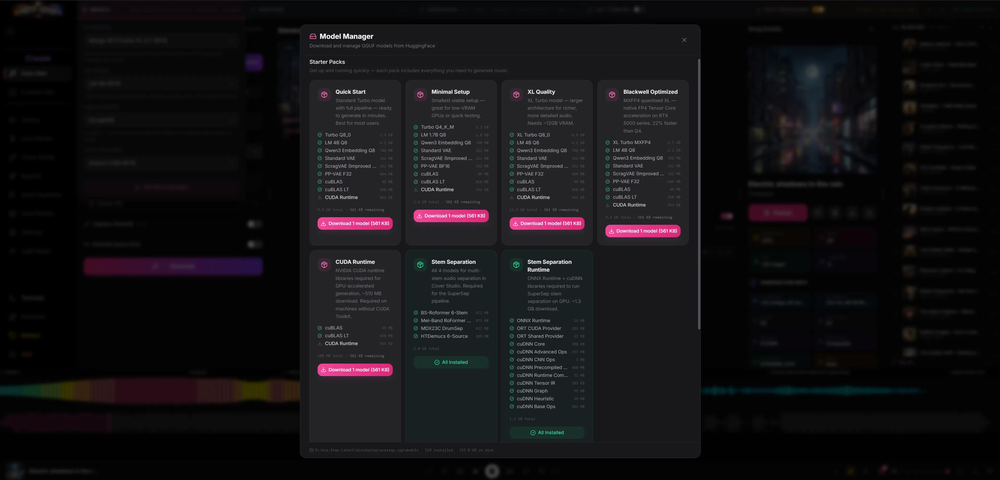

# Model Manager

Model Manager is where you browse, download, and remove the model files HOT-Step generates with: the DiT, the language model, the VAE, the text encoder, and the extra files specific backends and post-processing features need. Reach for it the first time you launch the app with nothing installed, when you want to try a different quantisation or a bigger model, or when a studio tells you a required file is missing.

## Where to find it

The **Get More Models** button at the bottom of the Models section in the global param bar opens it. When the active backend is MiniMax-Music3, YuE2 or Stable Audio 3, that section shows the backend's own model pickers instead of the ACE-Step 1.5 dropdowns; its equivalent button (**Get Models** when nothing is installed yet, **Get More Models** otherwise) opens the same modal. A few other spots open it too when a file they need is missing, such as the MiniMax-Music3 renderer row and the YuE2 training cards in Training Studio. When the active backend's model files are missing, the bottom of the global bar says so and its **Get models** button opens the modal; on a first run with an empty models folder, a banner under the global bar offers **Open Model Manager**.

Nothing needs to be running first. Model Manager talks to the Node server, not the engine, so it works even while the engine is still starting or is down entirely. On first launch, if the server still finds no DiT, LM, or VAE files after giving the engine 8 seconds to scan, it opens the modal automatically; closing it (the X button, the backdrop does not close it) keeps it from popping up again for the rest of that session.

## Workflow

1. Open Model Manager from the Models section of the global bar, or let it open on its own on first launch.
2. Pick a family tab: **ACE-Step 1.5**, **MiniMax-Music3**, **YuE2**, **Stable Audio 3**, **HeartMuLa**, or **Shared**. This also filters the starter packs above the catalogue.
3. For a quick setup, download a **Starter Pack**: one click installs every file it lists, and the card shows how much is left to fetch.
4. Or scroll down to **All Models** and pick files yourself. Families with more than one role show role sub-tabs underneath (DiT Models, Language Models, Text Encoder, VAE, PP-VAE for ACE-Step 1.5; Stem Separation, Whisper, Captioning (MOSS), MIDI Transcription for Shared); MiniMax-Music3 and YuE2 list their files directly, grouped by quant on the YuE2 tab.
5. Click **Download** on a row. Progress shows inline on that row and in the Active Downloads banner at the top, with percent, speed, and ETA.
6. If a download stalls or fails, click **Resume** to pick it up where it left off, or **Cancel** to stop it.
7. Click the trash icon on an installed file, then confirm, to remove it and free disk space.
8. Close with the X button. The footer shows the models folder path, how many files are installed, and total disk used.

See [the model list](../models.md) for every file in the catalogue: exact filenames, sizes, and source repos.

## Controls

| Control | What it does |
|---|---|
| Family tabs | ACE-Step 1.5 / MiniMax-Music3 / YuE2 / Stable Audio 3 / HeartMuLa / Shared. Filters the Starter Packs section above and the catalogue below to the same family; the choice is remembered between visits. |
| Starter Packs | Pre-bundled sets of files for a complete pipeline, for example Quick Start (standard Turbo, full pipeline) or Minimal Setup (smallest viable, low VRAM). Download installs every missing file in the pack; a fully-installed pack shows All Installed. |
| Role sub-tabs | Shown under families with more than one role. Each label carries an installed/total count. |
| Info button | On the DiT size groups and the MiniMax-Music3 TensorRT group, opens a short explanation of the group inline under its header. The other roles show their explanation as a block above the list. |
| Model row | One file: display name, quant badge, size, and a Download / Update / Installed control. Hover an installed row to reveal Delete, which asks for confirmation once. |
| Download progress | Percent, transfer speed, and ETA while a file is downloading; Resume for a paused or failed job, Cancel for one still queued or in progress. |
| License acceptance (Stable Audio 3 tab) | A toggle gating every download in that tab until you accept the Stability AI Community License. |
| Hugging Face token (Stable Audio 3 tab) | Optional, only needed if a source repository is gated. Stored in this browser and sent only to huggingface.co, with every Model Manager download once it is set, not only StableStep files. |

## Tips and limits

**Roles.** DiT is the model that denoises audio latents; LM (language model) turns your caption and lyrics into the audio-code sequence the DiT conditions on; the text encoder embeds the caption for the DiT and is architecturally fixed, you need exactly one; VAE decodes latents to audio and, for ACE-Step cover/repaint/extend, encodes audio back into latents; PP-VAE is an optional polish pass. MiniMax-Music3 and YuE2 are separate backends with their own LM, DiT/flow, and decoder roles. Stable Audio 3 is a backend too, and its dedicated tab also supplies StableStep post-processing: the generation DiT (`sa3-dit-BF16.gguf` plus a ladder of experimental quants), the SAME encoder and decoder, the T5Gemma text encoder and the tokenizer files. The backend reports its models missing unless `sa3-dit-BF16.gguf` and the tokenizer (`tokenizer.json`) are installed; the quants are extra choices in its Flow DiT picker. The same tab lists the SA3 Medium Base checkpoints (`sa3-dit-base-*`) for adapter training. **Download generation set** fetches only the seven default generation files, leaving alternative quants and training weights optional. Starter packs also wait for license acceptance. Stem separation, Whisper, and MOSS captioning are shared utility models used by Cover Studio and the Stem Separator, lyric transcription, and Training Studio respectively, not by generation itself. The MIDI Transcription section (Shared) lists MuScriptor Small, Medium and Large and Beat This! for MIDI Studio. Each is its weights plus a `config.json`, and it shows Installed only when both are present. The MuScriptor weights are gated on Hugging Face (CC BY-NC 4.0): request access on the model's page, then save a read token in MIDI Studio or on the Stable Audio 3 tab before you download, or the row fails with a hint saying so. Beat This! is not gated. HOT-Step does not host the gated weights. The files go to `models/muscriptor/<model>`, a download from an earlier release under `library/models/muscriptor` is still used where it is, and the MIDI Studio download buttons run the same job, so the two screens never fetch a model twice. YuE2's optional SheetSage2 model transcribes source audio into ABC for a cover; supplying an approved ABC score skips that model.

**Quant levels.** BF16 / F32 / F16 are reference precision, largest and best quality. Q8_0 is near-lossless, about half the size. Q6_K and Q5_K_M stay close to source quality with a real size saving, Q5_K_M smaller again than Q6_K. Q4_K_M / Q4_K_S are the compact end, noticeably smaller for lower-VRAM setups; on the YuE2 ladder these and the ranks below them are imatrix-guided, which keeps quality up further down the scale than a plain quant of the same size would. MXFP4 and NVFP4 are FP4 formats: MXFP4 gets native Tensor Core acceleration on RTX 5000-series (Blackwell) GPUs, with the same quality and compression as a software fallback on older cards; NVFP4 is experimental and scores below the k-quants above it in testing so far. The two SA3 ladders on the Stable Audio 3 tab add IQ1 to IQ4 quants and carry each k-quant both plain and imatrix-guided (`-imat`); every SA3 quant is marked experimental, with audible quality not yet verified, and BF16 stays the default. The registry only states VRAM numbers for a few entries directly: the XL Quality starter pack needs about 12 GB, Minimal Setup targets low-VRAM cards, and MiniMax-Music3 needs about 24 GB to hold its language model and flow stack loaded together. Elsewhere, quant descriptions speak to size and quality, not an exact VRAM figure.

**Manual installs.** A file you add by hand must sit directly in the models folder (`models` in the data folder by default, or `models/` in a development checkout without one; the footer here shows the path, and Settings > Environment > Models directory changes it, which needs an app restart to take effect), not in a subfolder. The engine only scans that top level for loose GGUF/safetensors files, but Model Manager's own installed check also looks one folder down, so a file left in a subfolder can show Installed here while staying invisible to generation. Restart the app after adding a file so the engine picks it up.

**Restart after downloading ACE-Step 1.5 files.** The engine reads its ACE-Step 1.5 model list only when it starts, so new DiT, LM, VAE or text encoder files reach the dropdowns after **Restart** in the sidebar. The exception is a first run with an empty models folder: the engine waits, and starts by itself once the download queue finishes.

**Installed files are checked in the background.** A matching filename initially shows Installed. The catalogue carries a SHA-256 for every file whose Hugging Face LFS metadata provides one, covering model weights and runtime libraries. Installed copies are hashed one file at a time, smallest first, and a mismatch shows **Update**. Completed checks are cached across restarts until the file's size or modification time changes; new checks wait while generation, training or other jobs are busy. Three small JSON entries have no published content hash and keep the filename check. Downloads also check the declared SHA-256 before keeping a file, alongside the expected size within 5% and the `.gguf` or `.dll` header where applicable.

**Downloads run concurrently.** Start as many files as you like at once; each gets its own row in the Active Downloads banner and its own progress bar, cancel, and resume control.

**Runtime files install elsewhere.** CUDA/cuDNN DLLs and TensorRT runtime files install into `tools/runtime` in the data folder for a release, or next to the engine binary in a development checkout, not into the models folder, even though they appear as rows and packs here. TensorRT builder resources are GPU-specific; the MiniMax-Music3 TensorRT group marks the one that matches your GPU when it can detect it.

Closing and reopening Model Manager within 30 seconds reuses the recent
catalogue. Download completion, reconnection and model deletion refresh the
catalogue and backend availability. Downloads are commands you start explicitly;
reopening the manager does not start them again.

HeartMuLa has three matching global/local LM variants, each with the full quant ladder, plus codec flow, scalar decoder, RVQ and tokenizer. Its optional encoder pack is separate. All listed HeartMuLa components download from the public HeartMuLa-GGUF repository. See the [model card](../../dev/heartmula-model-card.md) and [publication staging](../../dev/heartmula-publishing.md) for exact component coverage and missing encoder variants.

## Related

- [Getting started](../getting-started.md)
- [Backends](../backends.md)
- [Settings](settings.md)
- [Models](../models.md)
- [Troubleshooting](../troubleshooting.md)

## Release data paths

Release downloads use the shared data folder for models and downloaded runtime libraries. Upgrading reuses these files through the saved profile location. See [Data folder and upgrades](../data-folder.md).
